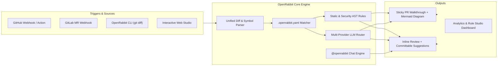

# 🐇 OpenRabbit

**Open-Source AI Pull Request Reviewer, Walkthrough Generator & Interactive PR Companion**  
*An open-source, self-hostable, multi-provider BYOK alternative to CodeRabbit.*

---

## ✨ Why OpenRabbit?

Code reviews shouldn't require surrendering your proprietary source code to a closed SaaS or paying per-seat enterprise fees. **OpenRabbit** brings the signature capabilities developers love about CodeRabbit into a fast, transparent, open-source platform:

1. **🧭 Two-Stage PR Walkthroughs**:
   - Executive Summary & Release Notes grouped by module
   - File-by-File Walkthrough Table with component detection & impact badges (`🟢 Low`, `🟡 Med`, `🔴 High`)
   - Auto-generated **Mermaid Sequence Diagrams** (`sequenceDiagram`) visualizing how PR changes interact at runtime
   - **Review Effort Score** (`1/5` to `5/5`) & Risk Assessment
   - Configurable **Rabbit Poem** summarizing every PR 🐇🥕
   - Updates a single sticky comment (`<!-- openrabbit-walkthrough -->`) on new commits instead of spamming your PR!
2. **📝 Line-by-Line Inline Code Reviews with One-Click Committable Suggestions**:
   - Pinpoints exact diff lines and emits GitHub (` ```suggestion `) and GitLab (` ```suggestion:-0+0 `) committable code blocks.
   - Combines a built-in deterministic **Static + AST Security/Concurrency Analyzer** with **Multi-Provider LLMs**.
3. **💬 Interactive `@openrabbit` PR Chat & Commands**:
   - Reply in any PR or inline review thread with:
     - `@openrabbit explain` — Deep-dive explanation of the hunk & execution flow
     - `@openrabbit test` — Generates ready-to-run unit test suites (`Vitest`/`Jest`) for the modified functions
     - `@openrabbit fix` — Produces a committable replacement patch
     - `@openrabbit docstring` — Generates JSDoc/TSDoc for changed symbols
     - `@openrabbit resolve` — Marks the review discussion resolved
4. **🔑 Multi-Provider BYOK + 100% Private Local Mode**:
   - **OpenAI** (`gpt-4o`, `o3-mini`, or any compatible endpoint like Groq, DeepSeek, OpenRouter)
   - **Anthropic Claude** (`claude-3-7-sonnet-latest`)
   - **Google Gemini** (`gemini-2.5-pro`, `gemini-2.5-flash`)
   - **Ollama** (`qwen2.5-coder`, `deepseek-r1`, `llama3.3` for 100% air-gapped private reviews)
   - **Built-in Static/AST Heuristic Engine** (works immediately with zero API keys!)
5. **⚙️ Drop-in `.openrabbit.yaml` & `.coderabbit.yaml` Compatibility**:
   - Supports `profile: chill | assertive | security-focused`, glob `path_filters`, and per-directory `path_instructions`.

---

## 🏗️ Architecture



---

## 🚀 Quickstart

### 1. Run a Terminal PR Review (`openrabbit review`)

```bash
# Install dependencies
npm install

# Run a live terminal review on a sample PR (or your local uncommitted git diff)
npm run review -- --demo auth-jwt-sqli

# Review your staged git changes
npx tsx src/cli/index.ts review --staged

# Ask @openrabbit to generate unit tests from the CLI
npx tsx src/cli/index.ts chat "@openrabbit generate unit tests"
```

### 2. Launch the Interactive Web Dashboard & Webhook Server (`openrabbit serve`)

```bash
npm run dev
```

Then open **`http://localhost:3847`** to explore:
- **🔎 PR Review Studio**: Paste any `git diff`, switch between curated PR scenarios, inspect the rendered **Mermaid Sequence Diagram**, click **✨ Apply Fix to Diff & Re-Verify** on committable suggestions, and chat with `@openrabbit` inline!
- **📊 Reviews & Analytics**: Track PRs reviewed, critical vulnerabilities caught, and engineering hours saved.
- **⚙️ `.openrabbit.yaml` Studio**: Visually configure `chill` vs `assertive` profiles, `path_instructions`, and BYOK LLM providers.
- **🔌 Webhook Simulator**: Test GitHub (`pull_request`, `issue_comment`) and GitLab (`Merge Request Hook`) webhooks with one click.

---

## ⚙️ Configuration (`.openrabbit.yaml`)

```yaml
language: en-US
profile: chill # chill | assertive | security-focused
tone_instructions: Be constructive, concise, and high-signal.
reviews:
  high_level_summary: true
  poem: true
  sequence_diagrams: true
  collapse_walkthrough: false
  path_filters:
    - "!dist/**"
    - "!*.lock"
  path_instructions:
    - path: "src/api/**"
      instructions: "Verify authentication checks, input validation, and parameterized SQL queries."
    - path: "**/*.tsx"
      instructions: "Check for React hook dependency bugs and memory leaks."
chat:
  auto_reply: true
llm:
  provider: auto # auto | openai | anthropic | gemini | ollama | heuristic
  temperature: 0.2
```

---

## 🧪 Running Tests & Building

```bash
# Run the automated unit & webhook integration test suite
npm test

# Compile TypeScript to dist/
npm run build
```

## 📄 License

MIT
