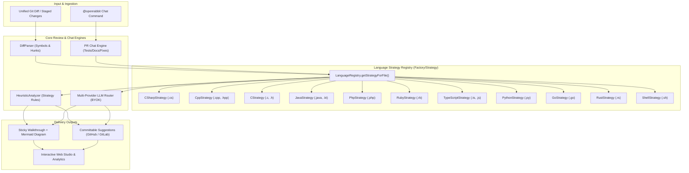

# 🐇 OpenRabbit

**Open-Source AI Pull Request Reviewer, Walkthrough Generator & Interactive PR Companion**  
*An open-source, self-hostable, multi-provider BYOK alternative to CodeRabbit.*

---

## ✨ Why OpenRabbit?

Code reviews shouldn't require surrendering your proprietary source code to a closed SaaS or paying per-seat enterprise fees. **OpenRabbit** brings the signature capabilities developers love about CodeRabbit into a fast, transparent, open-source platform:

1. **🧭 Two-Stage PR Walkthroughs**:
   - Executive Summary & Release Notes grouped by module
   - File-by-File Walkthrough Table with component detection & impact badges (`🟢 Low`, `🟡 Med`, `🔴 High`)
   - Auto-generated **Mermaid Sequence Diagrams** (`sequenceDiagram`) visualizing how PR changes interact at runtime
   - **Review Effort Score** (`1/5` to `5/5`) & Risk Assessment
   - Configurable **Rabbit Poem** summarizing every PR 🐇🥕
   - Updates a single sticky comment (`<!-- openrabbit-walkthrough -->`) on new commits instead of spamming your PR!
2. **📝 Line-by-Line Inline Code Reviews with One-Click Committable Suggestions**:
   - Pinpoints exact diff lines and emits GitHub (` ```suggestion `) and GitLab (` ```suggestion:-0+0 `) committable code blocks.
   - Combines a built-in deterministic **Static + AST Security/Concurrency Analyzer** with **Multi-Provider LLMs**.
3. **🌐 Modular Multi-Language Architecture (Strategy & Factory Patterns)**:
   - Built on a decoupled **Strategy Pattern** (`ILanguageStrategy`) and **Registry Pattern** (`LanguageRegistry`), isolating all language-specific rules, symbol extraction, test scaffolding, and documentation generators into independent classes:
     - **C# / .NET** (`.cs`): Detects Entity Framework `FromSqlRaw` / `ExecuteSqlRaw` SQL injection, process-crashing `async void` methods, and thread-pool deadlocks from sync-over-async (`.Result` / `.Wait()`). Generates xUnit `[Fact]` test suites and XML doc comments.
     - **C++** (`.cpp`, `.cc`, `.cxx`, `.hpp`): Flags unbounded buffer functions (`sprintf`, `strcpy`), raw `new` allocations lacking RAII (`std::make_unique`), and polymorphic object slicing in catch-by-value (`catch (std::exception e)`). Generates GoogleTest (`TEST_F`) suites and Doxygen.
     - **C** (`.c`, `.h`): Catches unchecked dynamic allocation (`malloc` without NULL check) and unbounded string functions (`strcpy`, `strcat`, `gets`). Generates Unity/CUnit test runners and Doxygen comments.
     - **Java / Kotlin** (`.java`, `.kt`): Detects JDBC/JPA raw query concatenation, unclosed `AutoCloseable` streams without try-with-resources, and unsafe `Optional.get()`. Generates JUnit 5 test classes and Javadoc.
     - **PHP** (`.php`): Identifies PDO/MySQLi raw query SQL injection, unescaped superglobal output (Reflected XSS via `$_GET`/`$_POST`), and unescaped `exec()` / `shell_exec()`. Generates PHPUnit test suites and PHPDoc.
     - **Ruby** (`.rb`, `.rake`): Flags ActiveRecord string interpolation SQL injection (`where("tenant = '#{name}'")`), insecure deserialization (`YAML.load` vs `YAML.safe_load`), and unescaped command execution. Generates RSpec (`RSpec.describe`) specs and YARD docs.
     - **TypeScript / JavaScript** (`.ts`, `.tsx`, `.js`, `.jsx`): Flags async `.forEach()` race conditions, loose equality `==`, uncleaned event/timer leaks, and React hook dependencies. Generates Vitest/Jest suites and TSDoc.
     - **Python** (`.py`): Catches mutable default args (`def f(x=[])`), raw f-string SQL injection, `shell=True` subprocesses, and bare `except:`. Generates `pytest` test suites with `@pytest.mark.asyncio` and PEP-257 docstrings.
     - **Go** (`.go`): Detects missing `defer resp.Body.Close()`, `fmt.Sprintf` SQL queries, and unhandled errors (`_ = ...`). Generates table-driven `go test` suites.
     - **Rust** (`.rs`): Flags unhandled production `.unwrap()` calls (suggesting `?` or `.unwrap_or_default()`) and unannotated `unsafe` blocks. Generates `cargo test` suites and Rustdoc.
     - **Shell / Bash** (`.sh`, `.bash`): Enforces `set -euo pipefail` strict mode and flags unquoted expansions.
4. **💬 Interactive `@openrabbit` PR Chat & Commands**:
   - Reply in any PR or inline review thread with:
     - `@openrabbit explain` — Deep-dive explanation of the hunk & execution flow
     - `@openrabbit test` — Generates language-idiomatic unit tests (`pytest`, `go test`, `cargo test`, `JUnit 5`, `xUnit`, `GoogleTest`, `PHPUnit`, `RSpec`, `Vitest`)
     - `@openrabbit fix` — Produces a committable replacement patch matching language idioms
     - `@openrabbit docstring` — Generates language-standard docstrings (PEP-257, Javadoc, XML Doc, Doxygen, PHPDoc, YARD, TSDoc)
     - `@openrabbit resolve` — Marks the review discussion resolved
5. **🔑 Multi-Provider BYOK + 100% Private Local Mode**:
   - **OpenAI** (`gpt-4o`, `o3-mini`, or any compatible endpoint like Groq, DeepSeek, OpenRouter)
   - **Anthropic Claude** (`claude-3-7-sonnet-latest`)
   - **Google Gemini** (`gemini-2.5-pro`, `gemini-2.5-flash`)
   - **Ollama** (`qwen2.5-coder`, `deepseek-r1`, `llama3.3` for 100% air-gapped private reviews)
   - **Built-in Static/AST Heuristic Engine** (works immediately with zero API keys!)
6. **⚙️ Drop-in `.openrabbit.yaml` & `.coderabbit.yaml` Compatibility**:
   - Supports `profile: chill | assertive | security-focused`, glob `path_filters`, and per-directory `path_instructions`.

---

## 🏗️ Architecture & Design Patterns

OpenRabbit is engineered with clear separation of concerns using classic GoF design patterns:

- **Strategy Pattern (`ILanguageStrategy`)**: Each programming language implements a standardized strategy defining file extension bindings, symbol extractors, deterministic static AST rules, quick fix generators, and test/doc scaffolds.
- **Factory / Registry Pattern (`LanguageRegistry`)**: Central singleton registry providing $O(1)$ strategy lookup and file routing. Adding support for a new language requires only implementing `ILanguageStrategy` and registering it—zero core engine modifications needed!



---

## 🚀 Quickstart

### 1. Run a Terminal PR Review (`openrabbit review`)

```bash
# Install dependencies & build
npm install
npm run build

# Review curated multi-language demos across all supported ecosystems:
npm run review -- --demo csharp-aspnet-sqli    # C# (.NET Entity Framework SQLi & async void)
npm run review -- --demo cpp-engine-buffer      # C++ (Unsafe sprintf, raw new, catch-by-value)
npm run review -- --demo c-crypto-buffer        # C (Unchecked malloc & strcpy)
npm run review -- --demo java-spring-sqli       # Java (JDBC SQLi & unclosed streams)
npm run review -- --demo php-laravel-sqli       # PHP (PDO SQLi, XSS echo, exec injection)
npm run review -- --demo ruby-rails-sqli        # Ruby (ActiveRecord SQLi, YAML.load RCE)
npm run review -- --demo python-fastapi-sqli    # Python (Mutable defaults, SQLi, shell=True)
npm run review -- --demo go-microservice-leak   # Go (Missing defer Body.Close, fmt.Sprintf SQL)
npm run review -- --demo rust-systems-unwrap    # Rust (Production unwrap() panics)
npm run review -- --demo auth-jwt-sqli          # TypeScript (JWT secret leak, SQLi, async forEach)

# Review your own staged git changes across any repository
npx tsx src/cli/index.ts review --staged

# Review a specific local repository and commit on your filesystem
npx openrabbit repo add /path/to/my-repo
npx openrabbit repo commits /path/to/my-repo
npx openrabbit review --repo-path /path/to/my-repo --commit <sha>
npx openrabbit review --repo-path /path/to/my-repo --range HEAD~3..HEAD

# Review live remote PRs on demand (GitHub, GitLab, Bitbucket)
npx openrabbit review --github owner/repo#123
npx openrabbit review --gitlab project/id#45
npx openrabbit review --bitbucket workspace/repo#78

# Ask @openrabbit to generate language-specific unit tests or fixes
npx tsx src/cli/index.ts chat "@openrabbit generate unit tests"
npx tsx src/cli/index.ts chat "@openrabbit fix this vulnerability"
```

### 2. Launch the Interactive Web Dashboard & Webhook Server (`openrabbit serve`)

```bash
npm run dev
```

Then open **`http://localhost:3847`** to explore:
- **🔎 PR Review Studio**: Paste any `git diff` or select directly from registered local repositories and commits, inspect the rendered **Mermaid Sequence Diagram**, click **✨ Apply Fix to Diff & Re-Verify** on committable suggestions, and chat with `@openrabbit` inline!
- **📁 Local Repos & Commits**: Connect any git repository on your filesystem, explore commit history with author and file diff stats, and trigger instant one-click reviews for any commit or uncommitted working tree changes.
- **📊 Reviews & Analytics**: Track PRs reviewed, critical vulnerabilities caught, and engineering hours saved.
- **⚙️ `.openrabbit.yaml` Studio**: Visually configure `chill` vs `assertive` profiles, `path_instructions`, and BYOK LLM providers.
- **🔌 Webhooks & Integrations**:
  - **Live On-Demand Review**: Enter any remote PR URL or identifier for GitHub, GitLab, or Bitbucket to review it directly.
  - **Webhook Simulator**: Test GitHub (`pull_request`, `issue_comment`), GitLab (`Merge Request Hook`), and Bitbucket (`pullrequest:created`, `pullrequest:comment_created`) webhooks with one click.

---

## ⚙️ Configuration (`.openrabbit.yaml`)

```yaml
language: en-US
profile: chill # chill | assertive | security-focused
tone_instructions: Be constructive, concise, and high-signal.
reviews:
  high_level_summary: true
  poem: true
  sequence_diagrams: true
  collapse_walkthrough: false
  path_filters:
    - "!dist/**"
    - "!*.lock"
  path_instructions:
    - path: "src/api/**"
      instructions: "Verify authentication checks, input validation, and parameterized SQL queries."
    - path: "**/*.tsx"
      instructions: "Check for React hook dependency bugs and memory leaks."
chat:
  auto_reply: true
llm:
  provider: auto # auto | openai | anthropic | gemini | ollama | heuristic
  temperature: 0.2
```

---

## 🧪 Running Tests & Building

```bash
# Run the automated unit & webhook integration test suite
npm test

# Compile TypeScript to dist/
npm run build
```

## 📄 License

MIT
